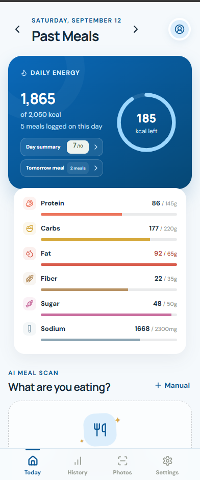
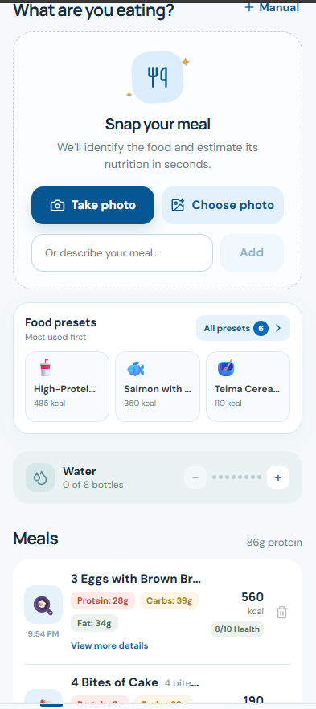

# Nourish

An iPhone-first meal and visual-progress tracker that uses Gemini 3.6 Flash to estimate nutrition and sort progress photos by pose. Every AI result can be reviewed or corrected.

<p align="center">
  
  &nbsp;&nbsp;
  
</p>

## Run locally

1. Copy `.env.example` to `.env` and add one or more Gemini keys as a comma-separated `GEMINI_API_KEYS` value. The server rotates the starting key for every analysis, retries another key when one is rate-limited or unavailable, and temporarily cools down failing keys.
2. Install and start:

```bash
npm install
npm run dev
```

By default everything binds to localhost: open `http://localhost:5173`. For the production build, use `npm run build` and `npm start`, then open `http://localhost:8787`.

To use it from your phone, set `API_HOST` and `DEV_HOST` in `.env` to a LAN or Tailscale IP, and list any extra hostnames in `DEV_ALLOWED_HOSTS`.

## Data and privacy

Meals, goals, water intake, and small meal thumbnails are stored in the browser's local storage and synced to the local server. A selected full-size meal image is sent to Gemini only after the user taps **Analyze meal**.

Progress-photo originals are stored locally in `server/progress/front-relaxed`, `server/progress/front-open`, or `server/progress/side`. When a progress photo is uploaded, it is sent to Gemini for pose-only classification into one of those three folders. The classifier is explicitly instructed not to identify the person or evaluate their body. The UI shows classification confidence and allows manual folder correction.

The progress folder is excluded from Git and the Docker build context. Docker Compose mounts it as a persistent local volume. API keys are loaded only by the server, never logged or returned to the browser, and are ignored by Git.

Photo-based nutrition values are estimates, not medical advice. Portions and values should be reviewed before saving.
